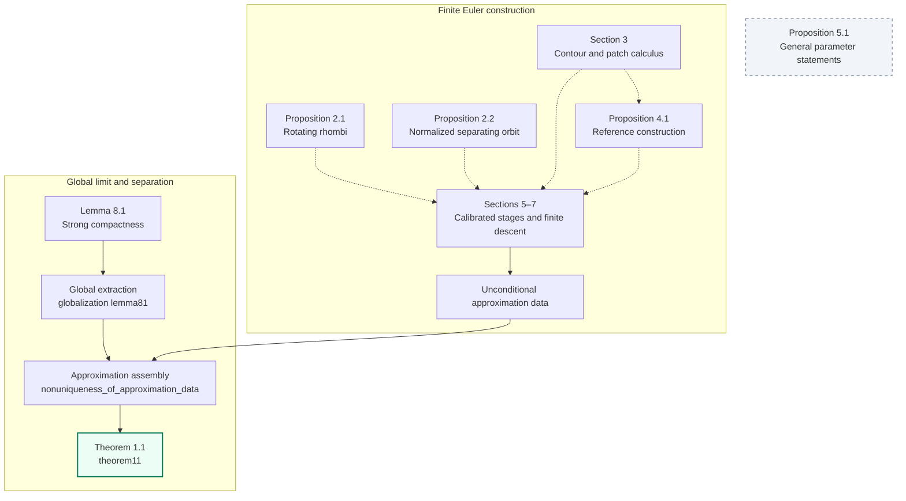

# Nonuniqueness of Solutions to 2D Incompressible Euler Equations with Unbounded Vorticity

A Lean 4 and Mathlib formalization of **Theorem 1.1**: two global solutions of the planar incompressible Euler equations share one compactly supported initial vorticity in every finite $L^p$, preserve its vorticity norms, and differ at time $1$.

The closed proof is [`EulerNonuniqueness.theorem11`](EulerNonuniqueness/Theorem11.lean). A [short statement and reading guide](EulerNonuniqueness/Statement.lean) and the [analytic definitions](EulerNonuniqueness/Definitions.lean) specify its mathematical content.

## The Euler equations and the solution class

Write $x^\perp=(-x_2,x_1)$ and let $dx$ denote Lebesgue measure on $\mathbb R^2$. The Biot–Savart kernel and velocity are

$$
K(x)=\frac{x^\perp}{2\pi |x|^2}\quad(x\ne0),\qquad K(0)=0,\qquad
u(t,x)=(K*\omega(t))(x)=\int_{\mathbb R^2}K(x-y) \omega(t,y) dy.
$$

We consider the vorticity form of the incompressible Euler equations,

$$
\partial_t\omega+u\cdot\nabla\omega=0,\qquad \nabla\cdot u=0,\qquad \omega(0)=\omega_0.
$$

The formalization identifies $\mathbb R^2$ with $\mathbb C$ and uses the usual Euclidean norm, real inner product, Lebesgue measure, and quotient $L^p$ spaces.

A **global solution with initial datum $\omega_0$**, in the class used here, is a real-valued vorticity $\omega:[0,\infty)\times\mathbb R^2\to\mathbb R$ with velocity $u=K*\omega$ satisfying the following conditions.

1. For every real $1\le p<\infty$,
   
$$
\omega\in C([0,\infty);L^p(\mathbb R^2)),\qquad
u\in C([0,\infty);L^2(\mathbb R^2;\mathbb R^2)),
$$
   
$$
\omega(0)=\omega_0\ \text{a.e.},\qquad
\|\omega(t)\|_{L^p}=\|\omega_0\|_{L^p}\quad(t\ge0).
$$
   
   Both continuity assertions are strong. For each $t\ge0$, the Biot–Savart integral is absolutely integrable for almost every $x$, and $\nabla\cdot u(t)=0$ in distributions.

2. **Renormalized vorticity transport.** For every $T>0$, every $\varphi\in C_c^\infty(\mathbb R\times\mathbb R^2)$ vanishing for $t\ge T$, and every $\beta\in C^1(\mathbb R)$ with $\sup_{s\in\mathbb R}|\beta'(s)|<\infty$,
   
$$
\int_0^T \int_{\mathbb R^2}
\beta(\omega)\bigl(\partial_t\varphi+u\cdot\nabla\varphi\bigr) dx dt
+\int_{\mathbb R^2}\beta(\omega_0(x))\varphi(0,x) dx=0.
$$
   
   The choice $\beta(s)=s$ gives the weak vorticity equation.

3. **Weak momentum.** For every $T>0$ and every $\psi\in C_c^\infty(\mathbb R\times\mathbb R^2;\mathbb R^2)$ with $\nabla_x\cdot\psi=0$ and $\psi(t,x)=0$ for $t\ge T$,
   
$$
\int_0^T \int_{\mathbb R^2}
u\cdot\bigl(\partial_t\psi+(u\cdot\nabla)\psi\bigr) dx dt
+\int_{\mathbb R^2}(K*\omega_0)(x)\cdot\psi(0,x) dx=0.
$$
   
All integrands in these identities, including the initial trace terms, are required to be integrable. These conditions are the concrete predicate [`IsEulerSolution`](EulerNonuniqueness/Definitions.lean).

## Theorem 1.1

There exist a compactly supported function $\omega_0:\mathbb R^2\to\mathbb R$ and two global solutions $(\omega^{(1)},u^{(1)})$, $(\omega^{(2)},u^{(2)})$ in the class above such that

$$
\omega_0\in\bigcap_{1\le p<\infty}L^p(\mathbb R^2),
\qquad
\int_{\mathbb R^2}\omega_0 dx=0,
\qquad
u^{(j)}=K*\omega^{(j)}\quad(j=1,2).
$$

For every $1\le p<\infty$ and $j=1,2$,

$$
\omega^{(j)}\in C([0,\infty);L^p),\qquad
u^{(j)}\in C([0,\infty);L^2),
$$

$$
\omega^{(j)}(0)=\omega_0\ \text{a.e.},\qquad
\|\omega^{(j)}(t)\|_{L^p}=\|\omega_0\|_{L^p}\quad(t\ge0),
$$

while

$$
\|\omega^{(2)}(1)-\omega^{(1)}(1)\|_{L^1}>0.
$$

The **same initial datum and the same two evolutions** work simultaneously for every finite $p$. Each evolution satisfies both renormalized transport and weak momentum as defined above.

## A complete, unconditional proof

**Theorem 1.1 has no hypotheses and requires no additional analytic assumptions.** Its fully qualified Lean type is

```text
EulerNonuniqueness.theorem11 : EulerNonuniqueness.Theorem11
```

The proof constructs its approximation data and applies the proved compactness and separation argument. The repository contains no source admissions or user-written unsafe proof code. The final theorem's printed logical axiom dependencies are precisely Lean's standard foundations:

```text
propext, Classical.choice, Quot.sound
```

To check the complete development, install Elan, Git and Python 3, then run the following commands from the root of a clean checkout. Elan selects the pinned Lean toolchain.

```bash
lake exe cache get
bash verify.sh --full
```

After the build, check the closed final declaration and print its axioms directly:

```bash
lake env lean FullVerification.lean
```

[`FullVerification.lean`](FullVerification.lean) checks the proof against both the project statement and an [independent target importing only Mathlib](Challenge.lean). [`Comparator.lean`](Comparator.lean) proves that these two targets agree. The four target and comparison files are protected by logical-code digests, so editorial changes to comments preserve the statement while mathematical changes are detected.

The full verification driver builds the library, validates the complete native axiom catalog, and traverses declaration types and proof bodies, including opaque dependencies. It rejects nonstandard logical axioms and unsafe or partial proof dependencies. The [verification certificate](audit/THEOREM11_CERTIFICATE.json) records the checks and their scope.

## Proof architecture

The construction combines explicit point-vortex motions with controlled finite Euler patch evolutions. A descending cascade carries separation from the smallest scale to the largest. Uniform estimates produce two approximation sequences with a common initial limit; strong compactness preserves their equations and norms, and a fixed observation at time $1$ preserves their separation.

The diagram summarizes the key declarations in the table below. Solid arrows indicate proof inputs or applications; dashed arrows group the mathematical ingredients used across several modules. Gray denotes a definition of a mathematical statement.



The proof fixes $\alpha=1/2$ and retains the theorem's simultaneous quantification over every finite $p$. The Proposition 5.1 entries specify the broader parameter packages; the actual calibrated-stage construction supplies the finite families used by the closed proof.

### Key declarations

All declaration names below are fully qualified. The [complete declaration index](docs/DECLARATION_INDEX.md) also locates the auxiliary results and general lemmas.

| Item | Lean declaration | Role |
|---|---|---|
| Proposition 2.1 | [`EulerNonuniqueness.Section2.proposition21`](EulerNonuniqueness/Section2/RotatingRhombus.lean) | Rotating-rhombus motion, ODEs, impulse and noncollision |
| Proposition 2.2: normalized orbit | [`EulerNonuniqueness.Paper.normalizedSeparatingOrbit_exists`](EulerNonuniqueness/Section5/SeparatingOrbitConstruction.lean) | Separating orbit with normalization and quantitative scattering |
| Section 3 | [`EulerNonuniqueness.Paper.exists_material_finitePatchEvolution_from_separated_disks`](EulerNonuniqueness/Section3/SeparatedDiskMaterialExistence.lean) | Euler patch evolution with prescribed initial disks and material labels |
| Proposition 4.1 | [`EulerNonuniqueness.Paper.proposition41`](EulerNonuniqueness/Section4/ReferenceProposition.lean) | Reference construction and sharp bounds |
| Proposition 5.1 | [`EulerNonuniqueness.Paper.Proposition51FixedParametersStatement`](EulerNonuniqueness/Section5/CascadeStatement.lean); [`EulerNonuniqueness.Paper.Proposition51ExistenceStatement`](EulerNonuniqueness/Section5/CascadeStatement.lean) | Definitions of the general parameter statements |
| Sections 5–7 | [`EulerNonuniqueness.Paper.exists_uniform_actual_stage_producers`](EulerNonuniqueness/Section5/CascadeUniformStageProducers.lean); [`EulerNonuniqueness.Paper.exists_physical_stage_family_of_next_stage_producer`](EulerNonuniqueness/Section5/CascadePhysicalStageDescent.lean) | Uniform stage construction and finite descent |
| Approximation data | [`EulerNonuniqueness.Paper.exists_actual_approximation_data`](EulerNonuniqueness/Section7/ActualApproximationExistence.lean) | Closed existence of the actual approximation sequences |
| Lemma 8.1 | [`EulerNonuniqueness.lemma81`](EulerNonuniqueness/Section8/CompactnessProof.lean) | Strong compactness, renormalization, conservation and momentum |
| Global extraction | [`EulerNonuniqueness.globalization`](EulerNonuniqueness/Section8/Globalization.lean) | Applied with Lemma 8.1 to obtain global solutions |
| Separation assembly | [`EulerNonuniqueness.nonuniqueness_of_approximation_data`](EulerNonuniqueness/Section8/Assembly.lean) | Transfers the fixed positive observation gap to the limiting solutions |
| Theorem 1.1 | [`EulerNonuniqueness.theorem11`](EulerNonuniqueness/Theorem11.lean) | Closed proof of the stated nonuniqueness theorem |

## Reproducibility and repository guide

The environment is fixed by [`lean-toolchain`](lean-toolchain) and [`lake-manifest.json`](lake-manifest.json):

| Component | Pinned version |
|---|---|
| Lean | `v4.19.0` |
| Mathlib | `v4.19.0`, commit `c44e0c8ee63ca166450922a373c7409c5d26b00b` |
| Elaboration | `autoImplicit = false` |

The [axiom runner](scripts/run_axiom_audit.py) executes the complete [`Audit.lean`](Audit.lean) catalog in bounded fresh Lean processes. It preserves the original command order and accepts the combined report only after every process and the complete coverage check pass. [`ProofAudit.lean`](ProofAudit.lean) performs the separate logical dependency traversal. Output is written under `build/`; downloaded dependencies, toolchains and generated artifacts are excluded from version control.

The [GitHub Actions workflow](.github/workflows/lean.yml) runs `bash verify.sh --full` for pull requests and `main`. Its external actions are pinned to commit hashes. The component-only command, `bash verify.sh --components`, runs the library and dependency checks; the full command additionally checks both closed target statements.

- [Statement and reading guide](EulerNonuniqueness/Statement.lean): the referee-facing theorem.
- [Analytic definitions](EulerNonuniqueness/Definitions.lean): kernels, function spaces, tests and integral identities.
- [Final proof](EulerNonuniqueness/Theorem11.lean): unconditional approximation data followed by global assembly.
- [Complete declaration index](docs/DECLARATION_INDEX.md): numbered results, auxiliary constructions and reusable lemmas.
- [Verification certificate](audit/THEOREM11_CERTIFICATE.json): completed checks and audit scope.

## Provenance

The cubical-Sperner and Brouwer foundations adapt [harfe/fixed-point-theorems-lean4](https://github.com/harfe/fixed-point-theorems-lean4), source commit `11a9f041246d28374edae384241757f9a0cbd5e4`, under the MIT license. The [provenance record and license](third_party/brouwer/README.md) accompany the port. These modules undergo the same kernel and logical dependency checks as the Euler development.
